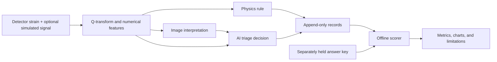

# LIGO-MCP: AI-Assisted Signal Triage and Evaluation

[](https://github.com/kellisonhering/ligo-mcp/actions/workflows/tests.yml)

A Python project that combines gravitational-wave signal processing, AI image
interpretation, and a controlled evaluation of the resulting decisions.

**The question:** when simulated signals are hidden in real detector noise, does
an AI triage layer help decide which recordings deserve human investigation?

**Current status, October 2026:** the 300-run campaign is complete and scored.
The original background experiment is stopped. The results exposed limitations
in both the numerical rules and AI integration; the repository includes the
scorer, tests, findings, and preparation tools for a follow-up study.

## Try It Without an API Key

Python 3.11 or newer is recommended. This demo uses invented records, makes no
AI calls, and downloads no detector data. It demonstrates grading and report
generation, not the live signal-processing pipeline.

```bash
git clone https://github.com/kellisonhering/ligo-mcp.git
cd ligo-mcp
python3 -m venv .venv
source .venv/bin/activate
python -m pip install -r requirements-demo.txt
python analyze_injections.py demo --output demo-output
```

Open `demo-output/REPORT.md` to read the report and view the accompanying charts.
Every demo result is explicitly marked as invented. Use a new output directory
for each run. [Setup and testing details](docs/SETUP.md) include Windows commands
and the optional full-pipeline dependencies.

## What Was Built

- **A detector-data pipeline:** public GWOSC strain data, Q-transform images,
  numerical features, H1/L1 coincidence checks, and external catalog checks.
- **An AI integration:** separate image interpretation and decision-making calls,
  structured outputs, version stamps, and explicit API failure records.
- **A controlled evaluation:** 200 simulated binary-black-hole signals and 100
  controls, with catch rules fixed before collection and labels kept out of the
  planner's inputs.
- **An offline scorer:** strict joins, frozen exclusions and replacements,
  confidence intervals, signal-strength curves, and a matched-filter yardstick.
- **Operational checks:** append-only JSONL records, numerical-validity gates,
  canary checks, integrity manifests, and an MCP interface.

**Stack:** Python, NumPy, SciPy, Matplotlib, GWpy, GWOSC, PyCBC, Anthropic's API,
FastMCP, pytest, and GitHub Actions. The free demo only needs NumPy and Matplotlib.



## Completed Evaluation

The campaign used real O3 noise with signals added to H1 and L1. All 300 active
records stamp Claude Sonnet 4.6 for both AI roles. These are the full operational
counts, including failure defaults:

| Frozen rule | Signal-containing windows flagged | Noise controls flagged |
| --- | ---: | ---: |
| Physics: chirp-like OR H1/L1 coincidence | 119/200 (59.5%) | 37/100 (37.0%) |
| AI: follow-up or human-review decision | 8/200 (4.0%) | 0/100 (0.0%) |


The numerical rule raised too many alarms on controls. AI escalation reduced
those alarms but passed over most injected windows. Zero observed AI alarms on
100 controls does not establish a zero false-alarm probability; its 95% interval
extends to about 3.7%.

Post-scoring inspection also found a test-design mismatch: signals were added
only to H1/L1, while AI reasoning sometimes treated absent Virgo confirmation
as negative evidence. The numerical chirp heuristic can compare unrelated
frequency peaks rather than track one continuous signal. These results measure
the implemented system and do not isolate a model's general scientific ability.

See the [full result summary and limitations](docs/RESULTS.md), including
uncertainty, failure accounting, the matched-filter comparison, and aggregate
machine-readable data. A flag in a signal-containing window is not proof that
the added signal caused it. This is an experimental evaluation, not a validated
astronomical search or a discovery claim.

## Engineering Decisions and Lessons

The project focuses on making failures observable and results inspectable:

- Failed external checks are distinguished from successful checks with no alert.
- Invalid source arrays are rejected mechanically, with excluded attempts retained.
- An early incorrect baseline rule is repaired during scoring from raw fields.
- API defaults stay in operational totals but are separated from available-call
  comparisons so a missing judgment is not presented as an AI opinion.
- Original grading outputs are preserved; changes are developed on open examples
  and need fresh hidden examples for independent validation.

[Engineering notes](docs/ENGINEERING.md) explain these choices and their limits.
This is an independent learning project developed with AI assistance from
Claude Code and Codex for implementation, review, testing, and documentation.

## Explore the Repository

| Area | Start here |
| --- | --- |
| Free demo and dependencies | [Setup](docs/SETUP.md) |
| Completed results and known limitations | [Results](docs/RESULTS.md) |
| Architecture and implementation choices | [Engineering notes](docs/ENGINEERING.md) |
| Scoring commands and conventions | [Scoring guide](SCORING_GUIDE.md) |
| Original review and locked catch rules | [Review findings, section 7.5](REVIEW_FINDINGS.md) |
| Original implementation phases | [Implementation plan](IMPLEMENTATION_PLAN.md) |
| Signal processing / AI / MCP interface | [pipeline.py](pipeline.py), [planner.py](planner.py), [server.py](server.py) |
| Offline scorer | [analyze_injections.py](analyze_injections.py), [campaign_scoring.py](campaign_scoring.py) |
| Tests | [tests/](tests/) and [CI workflow](.github/workflows/tests.yml) |

The July design review, locked rules, amendment history, code, and seal records
are retained. Their status notes describe their dates, not current operation.
The [previous public README](https://github.com/kellisonhering/ligo-mcp/blob/96d156409c72ce906fc0024d735f122ca3d083b1/README.md)
is also preserved as a [verbatim historical snapshot](docs/history/README-July-2026.md).

## Next Work

Local preparation tools create a 30-example development comparison with
consistent H1/L1 inputs and numbers-only versus image-assisted variants.
[Fable batch preparation](fable_batch_prep.py) prepares groups of five examples;
it does not submit requests. No Fable performance result is claimed. These
examples have already been opened and cannot serve as independent validation.

The original long-running experiment remains stopped. Running the demo or
preparation tools does not restart it or create paid model requests.

## Data and License

The public result files contain aggregate measurements and charts. Raw strain,
individual campaign records, truth-bearing pool files, credentials, and machine
configuration are not included. The free demo is reproducible without them;
independently re-scoring the original campaign requires its off-repository data.

This project uses public strain data from the
[Gravitational Wave Open Science Center](https://gwosc.org) (GWOSC), a service of
the LIGO Scientific Collaboration, the Virgo Collaboration, and KAGRA. LIGO is
funded by the U.S. National Science Foundation and operated by Caltech and MIT.
Virgo is funded by CNRS, INFN, and other European agencies and operated by the
European Gravitational Observatory. KAGRA is hosted by the Institute for Cosmic
Ray Research at the University of Tokyo.

No source-code license has been granted yet. The source remains publicly
viewable; the existing licensing status is unchanged. GWOSC data has its own
[usage and attribution terms](https://gwosc.org/acknowledgement/).
