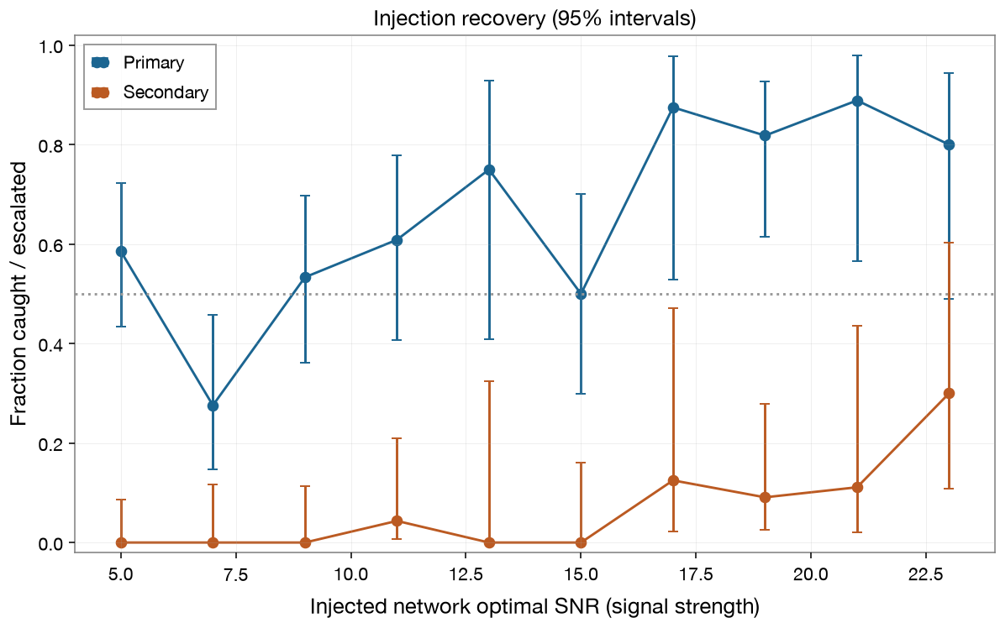
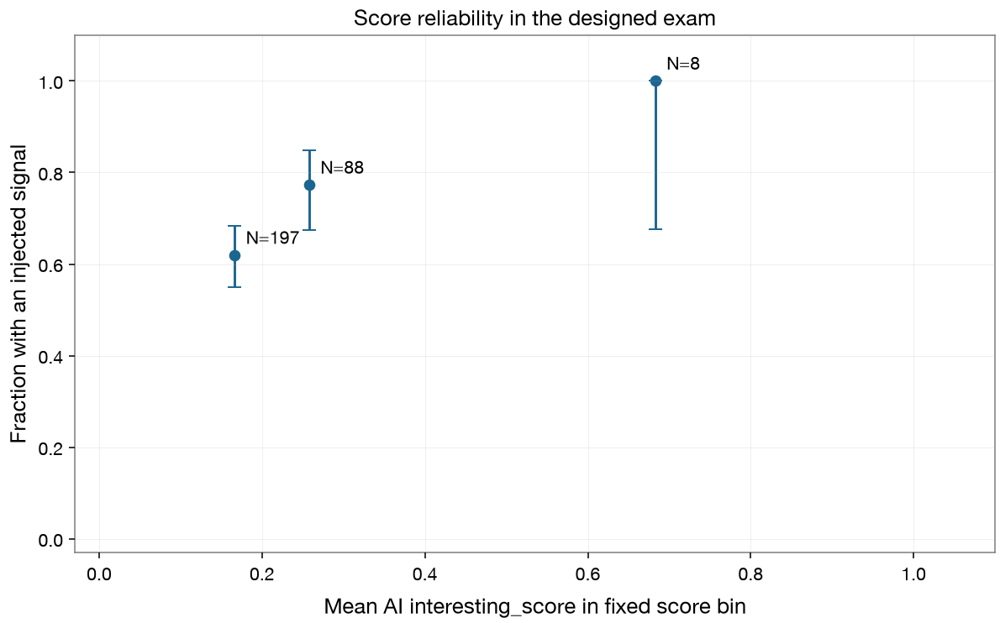
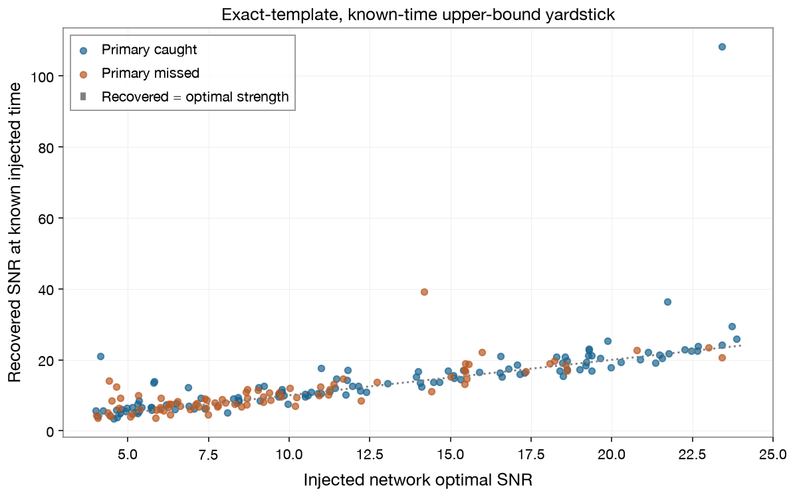

# Completed July Campaign: Results and Limitations

Scored October 18, 2026 (America/Chicago), with scorer 1.1.0. Published in the
portfolio update October 21, 2026. The evaluation contains 200 stellar-mass
binary-black-hole injections in real O3 noise and 100 controls with no added
signal. Labels were opened after the reviewed scorer was prepared.

All 300 active records stamp Claude Sonnet 4.6 for image interpretation and
planning. A model setting in a record does not prove a successful API call;
unavailable calls are accounted for below. This is not a comparison of newer
models and does not establish performance on subsolar signals or O4 data.

## Full Operational Results

| Rule and population | Flagged / total | Fraction | 95% Wilson interval |
| --- | ---: | ---: | ---: |
| Physics rule, injected windows | 119/200 | 59.5% | 52.6%-66.1% |
| Physics rule, noise controls | 37/100 | 37.0% | 28.2%-46.8% |
| AI escalation, injected windows | 8/200 | 4.0% | 2.0%-7.7% |
| AI escalation, noise controls | 0/100 | 0.0% | 0.0%-3.7% |

The physics rule is `chirp_like == true OR coincident == true`. AI escalation is
`follow_up` or `candidate_for_human_review`. Both are the original locked rules.
A flag on an injected window does not show that the added signal caused the
flag; an unrelated noise feature may trigger it. A control assignment means no
synthetic signal was added, not that every natural feature has been identified.

The physics rule exceeded the locked 10% control-alarm threshold. The AI layer
raised fewer alarms but passed over most added signals. No single primary SNR50
is reported because the observed curve has ambiguous crossings/touches. The AI
curve never reaches 50% on these bins. Neither permits a claimed SNR50 success.

## Errors and Denominators

The original JSONL contains 316 attempts. Sixteen attempted originals belong to
the frozen non-finite exclusion list and are not scored. The 300 active records
are 248 finite originals plus 52 separately sealed replacements. The full set of
52 invalid original specs was excluded, including those never attempted.

There were two planner errors, one vision error, and five pipeline/data errors
among active records. Error categories overlap. Five runs skipped the AI
entirely after data processing failed. Full operational rates above retain all
300 records and their safe-default decisions, following the July completeness note.

| Same available examples | Physics flagged | AI escalated |
| --- | ---: | ---: |
| Injected windows, N=198 | 119/198 (60.1%) | 8/198 (4.0%) |
| Controls, N=95 | 37/95 (38.9%) | 0/95 (0.0%) |

This supplementary view excludes API errors and skipped calls from both arms.
The July 30 API-error-only comparison is also in the aggregate JSON. These
different denominators are explicit; none replaces the locked operational result.
The paired differences are descriptive and have no significance claim.

## What the AI Scores and Matched Filter Mean

The interesting_score is a ranking score, not a probability. Its observed
injection fractions depend on the artificial 200:100 class balance. Unavailable
AI results are excluded from this chart. It cannot estimate the probability
that a real survey candidate is astronomical.

Matched-filter recovery uses each exact saved injection waveform, the saved
noise PSD, and the known injected time. All 200 injections received this check.
That is an optimistic comparison with information unavailable to a real search;
no template-bank search, matched-filter control alarm rate, or search sensitivity
is established. Large recovered values can include projection of noise features;
they are not evidence of a new astronomical event.

## Diagnosed Limitations

Post-scoring inspection identified two concrete design concerns. First, the
chirp heuristic compares frequency maxima in the two halves of a window rather
than following a signal. All 37 control flags passed that branch; none passed
H1/L1 coincidence. Second, the synthetic signals were added only to H1/L1, while
AI explanations sometimes used absent Virgo confirmation against them. Historical
gamma-ray and neutrino archives likewise receive no counterpart from an injection.

The image stage labelled 161 of the 200 injected windows as glitches, 36 as noise,
two as gravitational_wave, and one had no output. A glitch and an injection can
coexist, so these are not independently expert-verified image misclassification
counts. In the strongest missed example, the saved reasoning explicitly favored
the image glitch label and Virgo non-coincidence despite H1/L1 agreement.

These observations motivate repairs but do not establish which change will
improve performance or by how much. The result describes the collected system;
it is not an isolated measurement of Sonnet's general ability. The prepared
Fable follow-up has not been submitted, and no improved result is reported.

## Reproducibility and Historical Record

- [Aggregate metrics and provenance hashes](results/summary.json)
- [Bin counts and intervals, including the three frozen supplementary thresholds](results/efficiency.csv)
- [Public export checksums](results/SHA256SUMS.txt)
- [Scorer and reporting conventions](../SCORING_GUIDE.md)
- [Locked rules and later errata](../REVIEW_FINDINGS.md)
- [Original seal note](../campaign_seal/SEAL_NOTE.md) and [replacement seal note](../campaign_replacement_seal/SEAL_NOTE.md)

The export is a whitelisted aggregate subset of the completed local grading
folder. It excludes raw strain, per-record rows, answer keys, machine paths, and
credentials. Hashes link the subset to the original grading artifact; they do
not make the private pool publicly reproducible or prove that files were unread.
The original grading folder and historical rules were not edited for publication.
The [public export tool](../tools/export_campaign_summary.py) documents the subset.

Wilson intervals, conservative SNR50 handling, fixed score bins, the known-time
matched-filter convention, and the supplementary available-call comparison were
specified while building/reviewing the scorer before opening labels. They are
reporting choices beyond the original pre-registration's detail, not additions
claimed to have been locked in July.
